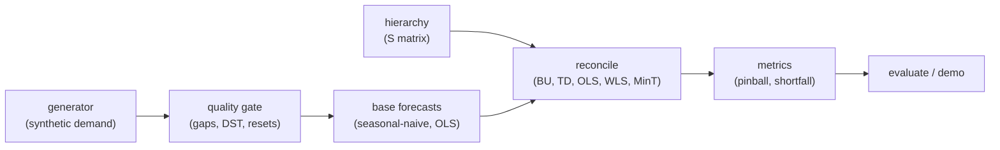

# hierforecast

Hierarchically reconciled energy demand forecasts, scored on pinball loss, so regional forecasts sum exactly to the national figure and the upper tail is right.

[](https://github.com/SlateGitOrg/hierforecast/actions/workflows/ci.yml)
[Live demo](https://slategitorg.github.io/hierforecast/)


## Why

A utility forecasts demand at national, regional and sub-regional level. Independent forecasts do not add up: planning, trading and network teams each see a different national number. Capacity decisions also need the upper tail rather than the mean, and a model tuned for average error is systematically wrong there. hierforecast produces forecasts that are coherent by construction (children sum to parents) and evaluates them on quantile (pinball) loss.

## Features

- Hierarchy defined as data; the summing matrix `S` is built automatically.
- Per-node base forecasts: seasonal-naive baseline and an OLS weather-and-calendar regression with harmonic terms.
- Reconciliation: bottom-up, top-down, OLS, structural and variance WLS, and MinT with Schafer-Strimmer shrinkage, all written out in pure Python (Gaussian elimination, Cholesky).
- Quantile forecasts from reconciled residuals, scored by pinball loss at p90, p95 and p99, plus capacity-shortfall rates.
- Data-quality gate for missing intervals, DST transitions and meter resets that fails loudly instead of forecasting through corrupt history.
- Synthetic generator with planted structure (temperature noise, cold snaps) so the methods can be checked against known truth.
- Browser demo in `site/` that runs the decision workflow client-side.

## Architecture



Base forecasts are fitted independently per node on a training window. The reconciler projects them onto the coherent subspace defined by `S`, using a weight matrix chosen by method (identity for OLS, the shrunk residual covariance for MinT). Because reconciliation is linear, residual-based quantiles can be pushed through it exactly.

## Quick start

Requires Python 3.11+. The core uses only the standard library, so there is nothing to install.

```bash
git clone https://github.com/SlateGitOrg/hierforecast
cd hierforecast
python -m unittest discover -s tests -v   # 30 tests, a few seconds
python -m src.demo                        # full experiment, about 2 s
```

## Usage and results

`python -m src.demo` (seed 20240) generates 17 nodes (1 national, 4 regions, 12 sub-regions) over 200 days, trains on the first 70% (3360 h) and scores the held-out 1440 h. Pinball loss is averaged over nodes, in MW. Trimmed output:

```text
method                rmse_all       nat    region       sub |     pb90     pb95     pb99 | max|incoh| MW
base (independent)      150.20     456.4     160.8      76.4 |    24.42    15.73     4.48 | 6.12e+02
bottom-up               212.91     725.5     207.0      76.4 |    27.86    16.97     4.77 | 5.46e-12
top-down                153.74     456.4     181.9      67.9 |    26.86    16.33     4.56 | 3.64e-12
ols                     144.56     467.8     151.3      60.4 |    22.29    14.75     4.31 | 9.09e-12
mint-shrink             146.95     457.8     163.5      63.8 |    22.25    14.53     4.30 | 1.27e-11
MinT pinball@0.95 vs bottom-up           : +14.3%
Seasonal-naive baseline: national RMSE 894.7 MW vs model 456.4 MW -> model beats baseline
```

- Independent forecasts disagree by up to 612 MW; after reconciliation the gap is float round-off.
- MinT's p95 pinball loss is 14.3% lower than bottom-up, 11.0% lower than top-down, 7.6% lower than the unreconciled base and 1.5% lower than OLS. Across seeds 1-6 the gain over bottom-up at p95 ranged 8.6-16.5%.
- The seasonal-naive baseline is always computed and reported, so a model that fails to beat it cannot pass silently.
- Loss choice matters: RMSE alone favours a Gaussian-tail model (national RMSE 456.4), but at its p99 capacity level it is short in 3.3% of hours against a nominal 1%. The same mean with an empirical residual tail is short in 0.8% of hours, with p99 pinball loss 21.81 against 28.45.

## Design notes

- **Coherence** is checked exactly: after reconciliation every parent equals the sum of its children within floating-point tolerance.
- **MinT vs OLS.** The estimated shrinkage intensity is about 0.003, so MinT is close to full-covariance GLS here and barely beats OLS; most of the gain over bottom-up comes from using the aggregate forecasts at all.
- **Quantiles** come from in-sample residuals pushed through the reconciler. This is exact because reconciliation is linear, but it is not conformal or out-of-sample calibrated.
- **Data-quality gate** (`src/quality.py`) raises `DataQualityError` on missing intervals, DST discontinuities and meter resets.
- More detail in [docs/ARCHITECTURE.md](docs/ARCHITECTURE.md).

## Testing

```bash
python -m unittest discover -s tests -v
node --test site/core.test.mjs      # browser-demo logic (Node 24)
python scripts/validate_site.py
```

Tests assert coherence after reconciliation, that MinT beats bottom-up on pinball loss on held-out data, that the seasonal-naive baseline is always reported, and that the quality gate rejects gaps, DST shifts and meter resets.

## Project layout

```text
src/
  hierarchy.py   tree and S matrix
  generator.py   planted synthetic demand
  forecast.py    seasonal-naive and OLS base models
  reconcile.py   BU / TD / OLS / WLS / MinT
  linalg.py      pure-Python linear algebra
  metrics.py     pinball loss, capacity shortfall
  quality.py     data-quality gate
  evaluate.py    experiments
  demo.py        python -m src.demo
tests/           unit and experiment tests
site/            browser demo
docs/            architecture notes and screenshots
```

## Limitations

- Data is synthetic; the results show the method recovers planted structure, not that it wins on real grid data.
- The hierarchy has 17 nodes. With around 180 nodes the covariance needs far more residual history or much heavier shrinkage.
- MinT's advantage depends on history length: with 120 days (84 training days) the gain over bottom-up at p95 ranged from -0.1% to +20% across seeds, and at p99 it was often negative.
- Evaluation is a single 70/30 split, not rolling-origin; there is no serving API or drift monitor.

## License

MIT — see [LICENSE](LICENSE).
