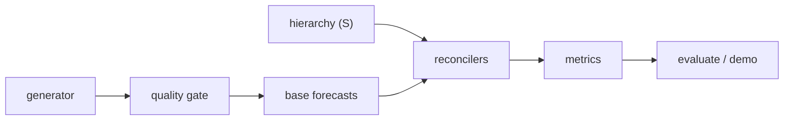

# Architecture

## Context

Utilities forecast demand at several levels of a hierarchy, and independently produced forecasts rarely add up. hierforecast builds base forecasts per node, reconciles them so the hierarchy is coherent, and scores the result on quantile loss because capacity planning depends on the upper tail.

## Container view

Everything is pure Python (standard library). `linalg.py` supplies Gaussian elimination and Cholesky; `reconcile.py` builds the projection `S (S' W^-1 S)^-1 S' W^-1` for each method.

## Key decisions

- **MinT with shrinkage** over bottom-up (coherent but noisy) and top-down (coherent but blind to local structure). Shrinkage keeps the residual covariance well conditioned with few observations per node.
- **Pinball loss** rather than MAE or RMSE, since a model tuned for the mean is confidently wrong in the tail. The demo compares a Gaussian tail with an empirical residual tail to show the difference.
- **Residual quantiles pushed through the reconciler**, which is exact because reconciliation is linear.
- **Quality gate first**, so corrupt history stops the run rather than silently degrading forecasts.

## Failure modes

- Gaps, DST shifts and meter resets raise `DataQualityError`.
- With short history the estimated covariance is noisy and MinT's gain over bottom-up becomes unreliable.
- A model that does not beat the seasonal-naive baseline is flagged in the demo output.

## Out of scope

Real grid data ingestion, rolling-origin backtesting, a serving API, drift monitoring and trading logic.
